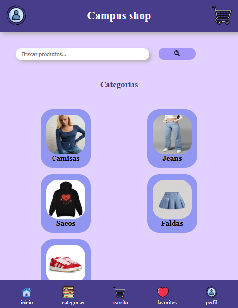
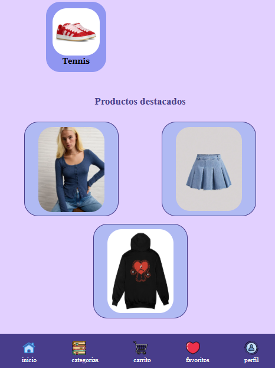
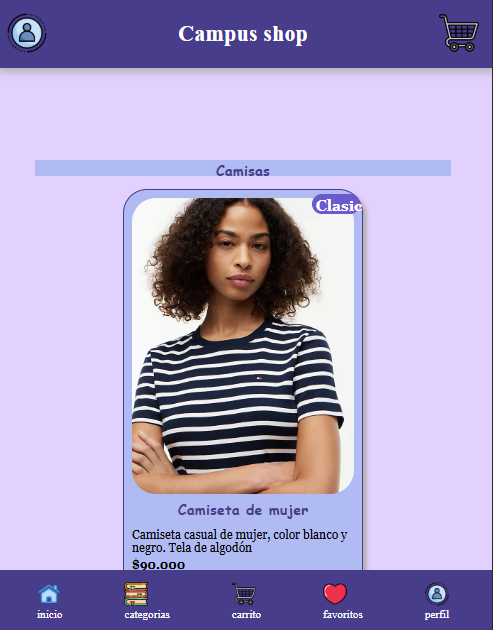
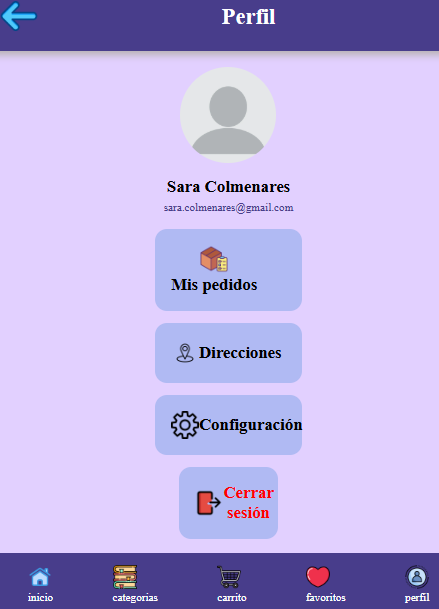
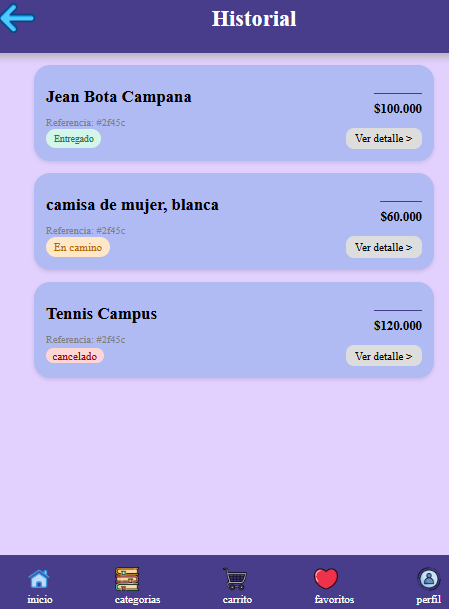
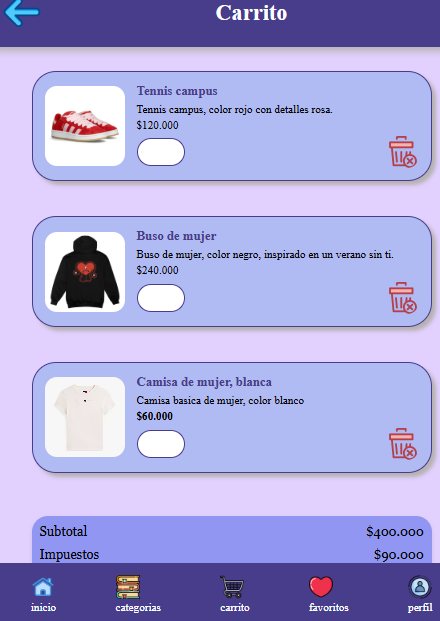
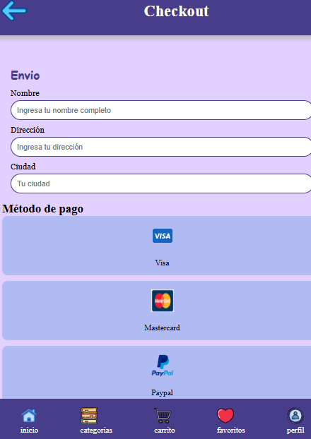
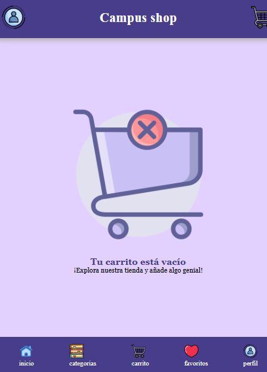

## Proyecto: CAMPUS SHOP
**Elaborado por:** Sara Colmenares
El proyecto 
 **Descripción del Proyecto**
- CampusShop es una aplicación web desarrollada como proyecto académico, enfocada en la maquetación de una tienda virtual para la compra y venta de productos dentro del entorno universitario.

El proyecto fue construido utilizando HTML5 y CSS, sin uso de JavaScript, siguiendo un enfoque mobile-first y respetando una estructura semántica clara. Se buscó replicar fielmente los wireframes y maquetas proporcionadas, logrando una interfaz limpia, moderna y funcional.

- Inicialmente, cree la estrucutura del proyecto. Primero se creo la carpeta raiz, la cual se nombró "CAMPUS SHOP", posteriormente se crearon los diferentes archivos HTML, y dos sub-carpetas, las cuales: una es para los archivos CSS y la otra para imagenes
 **Estructura del proyecto**

-Tienda-campus/
├── index.html
├── catalogo.html
├── producto.html
├── carrito.html
├── checkout.html
├── perfil.html
├── historial.html
├── vacio.html
│
├── css/
│   ├── base.css
│   ├── layout.css
│   ├── components.css
│   └── responsive.css
│
├── img/
│   └── (imágenes e iconos)
**Descripción de carpetas**
HTML: Contiene todas las vistas principales del E-Commerce.
CSS:
base.css: variables, reset y estilos globales.
layout.css: estructura (header, footer, contenedores).
components.css: tarjetas, botones, formularios.
responsive.css: media queries (tablet y desktop).
img/: recursos visuales utilizados en la interfaz.
**Navegación de la Aplicación**
**Home (index.html)**
-Página principal
-Buscador de productos
-Categorías destacadas
-Productos destacados
-Acceso rápido a otras vistas desde el footer
**Catálogo (catalogo.html)**
Visualización de productos organizados por categorías:
Camisas
Jeans
Faldas
Sacos
Tenis
Uso de CSS Grid para distribución responsive
Cada producto dirige a su vista de detalle
**Productos**:
Imagen principal del producto
Nombre, descripción y precio
Botón de compra (simulado)
Diseño centrado y limpio
**Carrito (carrito.html)**
Lista de productos agregados
Cantidad editable (simulada)
Eliminación visual de productos
Resumen de compra (subtotal, impuestos y total)
Botón de checkout
**Checkout (checkout.html)**
Formulario de envío:
Nombre
Dirección
Ciudad
Selección de método de pago (visual)
Resumen de la orden
Botón de pago.
**Perfil (perfil.html)**
Información del usuario
Accesos a:
Historial de pedidos
Configuración
Direcciones
Opción de cerrar sesión (simulada)
**Historial (historial.html)**
Listado de pedidos anteriores
Información por pedido:
Nombre del producto
Precio
Estado (Entregado, En camino, Cancelado)
Referencia.
**Estado vacío (vacio.html)**
Pantalla cuando el carrito no tiene productos
Mensaje informativo
Diseño centrado con ilustración.
**Diseño Responsive (Mobile-First)**
El proyecto fue desarrollado bajo la metodología mobile-first, lo que implica:
Diseño inicial optimizado para dispositivos móviles.
- Técnicas utilizadas:
CSS Grid → para catálogo de productos
Flexbox → para header, footer y layouts simples
Unidades flexibles (%, rem)
Imágenes adaptables (width: 100%).
Fidelidad al Mockup
**Fidelida al mockup**
**El diseño sigue las especificaciones del wireframe:**
Paleta clara con acentos violetas/azules
Tarjetas con bordes redondeados y sombras suaves
Tipografía simple y legible
Distribución limpia y organizada
Interfaz intuitiva.

**Cumplimiento de Requisitos**
- HTML5 semántico
- CSS modular en múltiples archivos
- Diseño responsive (mobile-first)
- Sin uso de JavaScript
- Interfaz completa tipo E-Commerce
- Consistencia visual
Navegación funcional entre vistas
- Conclusión
CampusShop cumple con los objetivos del proyecto al presentar una interfaz moderna, organizada y completamente responsive, demostrando el uso adecuado de HTML y CSS para la construcción de aplicaciones web sin necesidad de JavaScript.